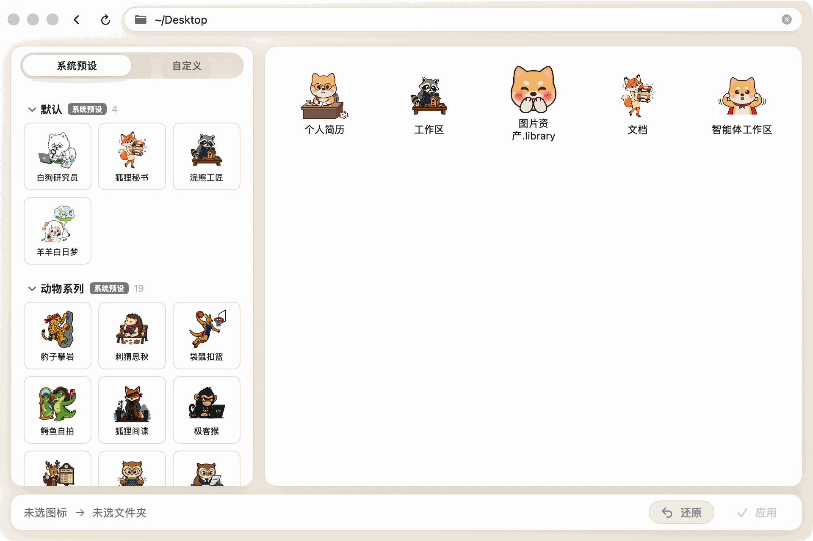
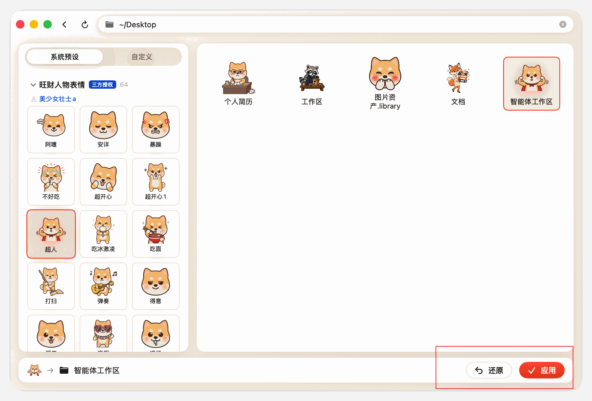
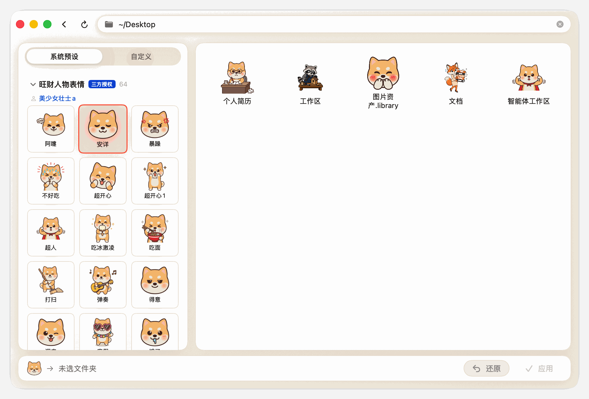

<div align="center">


# 小羊贴纸铺 · mie-iconner

**一款 macOS 文件夹图标修改工具:把喜欢的图片设为文件夹图标,也可以随时还原为系统默认。**

挑一张贴纸,贴到文件夹上——就像逛贴纸铺一样简单。

[](https://www.apple.com/macos/)
[](https://www.swift.org)
[](https://www.swift.org/package-manager/)



</div>

<br />

## ✨ 特性

<table>
  <tr>
    <td width="50%">
      <h3>🗂 贴纸库</h3>
      <p>内置 100 多张图标贴纸,开箱即用;也可以把自己的 PNG 图片拖进来,建成自己的分类。</p>
    </td>
    <td width="50%">
      <h3>🖥 桌面式浏览</h3>
      <p>右侧就是你的桌面:双击进入文件夹,地址栏支持返回上级、输入直达,还有路径自动补全。</p>
    </td>
  </tr>
  <tr>
    <td width="50%">
      <h3>⚡️ 一键应用 / 还原</h3>
      <p>选中贴纸和文件夹,点「应用」即刻换上新图标;点「还原」随时恢复系统默认。</p>
    </td>
    <td width="50%">
      <h3>🔄 与桌面同步</h3>
      <p>界面里看到的图标状态与访达实时一致,改了什么、没改什么,一眼就能看清。</p>
    </td>
  </tr>
</table>

<br />

## 🚀 安装与使用

### 下载与安装

1. 前往 [Releases 页面](https://github.com/xw-meow/mie-iconner/releases)下载最新的 DMG 安装包;
2. 双击打开安装包,把 **小羊贴纸铺** 拖进「应用程序」文件夹;
3. 打开「访达」,点按左侧边栏中的「应用程序」,找到 **小羊贴纸铺**。

### 首次打开:请右键点按「打开」

小羊贴纸铺没有经过 Apple 公证——它是一款免费开源的小工具,而 Apple 开发者认证每年需要 99 美元,对这样一个小工具来说并不划算。因此首次打开时系统可能提示「无法验证开发者」,这属于正常现象,操作一次即可:

1. 在「应用程序」中找到 **小羊贴纸铺**;
2. 按住 Control 点按它的图标(或直接右键点按),选择「打开」;
3. 在弹出的窗口中再点一次「打开」。

只需这一次,之后双击即可正常打开。如果系统提示「已损坏,无法打开」,请前往「系统设置 → 隐私与安全性」,点按页面下方的「仍要打开」。

### 使用方式

在左侧贴纸库选中一张贴纸,在右侧浏览器中选中目标文件夹,点击「应用」,文件夹图标即刻更换;点击「还原」恢复系统默认图标。

<p align="center">
  
</p>

<br />

## 🛠 开发指南

### 环境要求

- macOS 14 Sonoma 及以上
- Xcode 15+ / Swift 5.9+

### 构建与运行

```bash
git clone git@github.com:xw-meow/mie-iconner.git
cd mie-iconner/app
swift run mie-iconner
```

### 测试与打包

```bash
swift test                  # 运行单元测试(核心逻辑位于 MieIconnerCore,无 UI 依赖)
make package                # 仓库根目录执行:构建 universal release 并产出 DMG 安装包
```

### 仓库结构

```
app/                    # macOS 应用(SwiftPM)
├── Sources/
│   ├── mie-iconner/        # SwiftUI 界面(视图、设计 token、资源)
│   └── MieIconnerCore/     # 无 UI 依赖的核心逻辑:图标读写、路径解析、图标库
├── Tests/
│   └── MieIconnerCoreTests/
└── scripts/            # 打包脚本
site/                   # 官网(Vite + React,经 GitHub Actions 部署至 GitHub Pages)
imgs/                   # README 配图
```

### 自定义图标包

将 PNG 图片(建议 512×512)放入任意分类目录即可作为贴纸使用。每个分类可通过 `config.json` 配置元信息:

```json
{
  "priority": 10,
  "author": "美少女壮士a",
  "author_url": "https://www.iconfont.cn/...",
  "brandName": "三方授权",
  "brandColor": "#0958d9",
  "defaultExpanded": false
}
```

| 字段 | 说明 | 默认值 |
| --- | --- | --- |
| `priority` | 排序优先级,越大分类越靠前 | `0` |
| `author` | 作者名称,展开分类时首行展示 | 无 |
| `author_url` | 作者主页,名称变为可点链接 | 无 |
| `brandName` | 分类名后的徽标文字 | 无 |
| `brandColor` | 徽标背景色 | `#0958d9` |
| `defaultExpanded` | 是否默认展开 | `false` |

<p align="center">
  
</p>

<br />

<div align="center">

**小羊贴纸铺** — 让每个文件夹都与众不同

</div>
