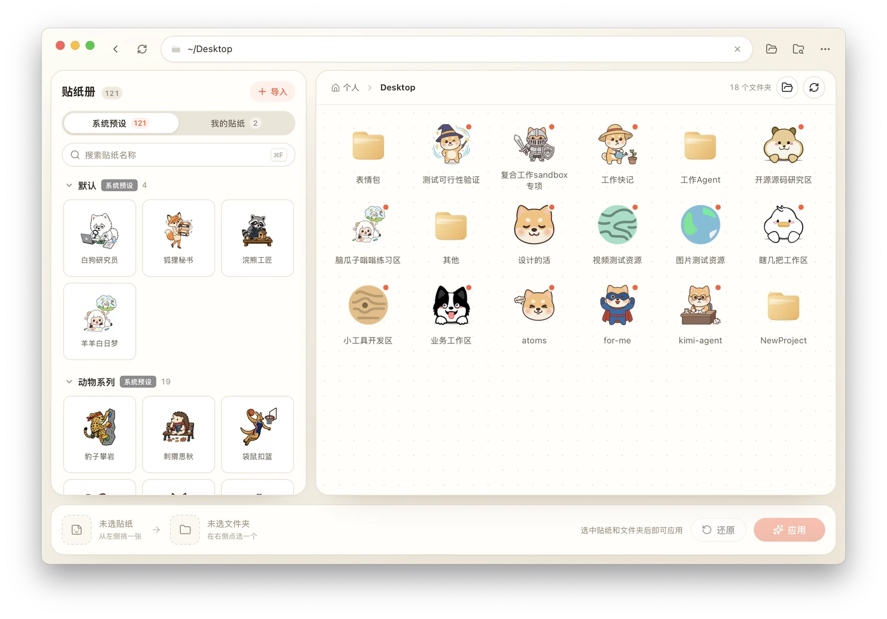
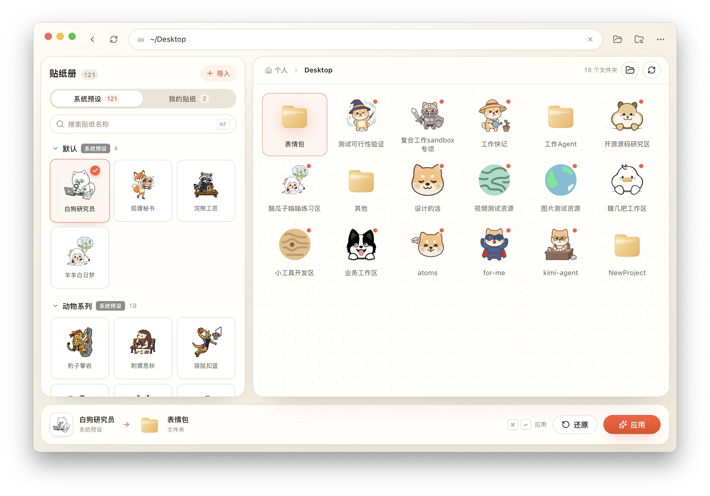

<div align="center">


# 小羊贴纸铺 · mie-iconner

**一款 macOS 文件夹图标修改工具：把喜欢的图片设为文件夹图标，也可以随时还原为系统默认。**

挑一张贴纸，贴到文件夹上——就像逛贴纸铺一样简单。

[](https://www.apple.com/macos/)
[](https://tauri.app)
[](https://react.dev)
[](https://www.rust-lang.org)
[](https://www.typescriptlang.org)



</div>

<br />

## ✨ 特性

<table>
  <tr>
    <td width="50%">
      <h3>🗂 贴纸册</h3>
      <p>内置 120 多张图标贴纸，开箱即用；支持分类折叠、即时搜索，也可以把自己的 PNG / JPG 拖进来。</p>
    </td>
    <td width="50%">
      <h3>🖥 桌面式浏览</h3>
      <p>右侧就是你的桌面：面包屑与地址栏补全、双击进入、右键菜单，找文件夹不用离开键盘。</p>
    </td>
  </tr>
  <tr>
    <td width="50%">
      <h3>⚡️ 一键应用 / 还原</h3>
      <p>选中贴纸和文件夹，点「应用」或按 ⌘↩ 即刻换上新图标；点「还原」恢复系统默认。</p>
    </td>
    <td width="50%">
      <h3>🔄 与访达同步</h3>
      <p>直接从磁盘解析 <code>Icon\r</code> 资源叉，不依赖 iconservices 缓存，界面和桌面看到的一致。</p>
    </td>
  </tr>
  <tr>
    <td width="50%">
      <h3>🖐 拖放导入</h3>
      <p>从 Finder 把图片拖到某个分类上松手即可导入；拖到空白处会先问你要放进哪个分类。</p>
    </td>
    <td width="50%">
      <h3>🔒 纯本地</h3>
      <p>不上传、不联网、不收集数据。所有图片和文件夹都只留在你的 Mac 上。</p>
    </td>
  </tr>
</table>

<br />

## 🚀 安装与使用

### 下载与安装

1. 前往 [Releases 页面](https://github.com/xw-meow/mie-iconner/releases)下载最新的 DMG 安装包；
2. 双击打开安装包，把 **小羊贴纸铺** 拖进「应用程序」文件夹；
3. 打开「访达」，点按左侧边栏中的「应用程序」，找到 **小羊贴纸铺**。

### 首次打开：请右键点按「打开」

小羊贴纸铺没有经过 Apple 公证：它是一款免费公开的小工具，而 Apple 开发者认证每年需要 99 美元，对这样一个小工具来说并不划算。因此首次打开时系统可能提示「无法验证开发者」，这属于正常现象，操作一次即可：

1. 在「应用程序」中找到 **小羊贴纸铺**；
2. 按住 Control 点按它的图标（或直接右键点按），选择「打开」；
3. 在弹出的窗口中再点一次「打开」。

只需这一次，之后双击即可正常打开。如果系统提示「已损坏，无法打开」，请前往「系统设置 → 隐私与安全性」，点按页面下方的「仍要打开」。

### 使用方式

在左侧贴纸册选中一张贴纸，在右侧浏览器中选中目标文件夹，点击「应用」（或按 ⌘↩），文件夹图标即刻更换；点击「还原」恢复系统默认图标。右键文件夹还可以直接在访达中显示、拷贝路径，或只对这一个文件夹应用当前贴纸。

<p align="center">
  
</p>

<br />

## 🛠 开发指南

### 技术栈

| 层 | 选型 |
| --- | --- |
| 桌面壳 | [Tauri 2](https://tauri.app)（Rust + 系统 WebView） |
| 前端 | [React 19](https://react.dev) + [Vite 8](https://vite.dev) + TypeScript 6 |
| 样式 | [Tailwind CSS v4](https://tailwindcss.com) 设计 token + 少量 CSS 动效 |
| 组件 | [Radix UI](https://www.radix-ui.com) 无障碍原语、[lucide-react](https://lucide.dev) 图标 |
| 数据 | [TanStack Query](https://tanstack.com/query) 管理 IPC 数据、[Zustand](https://zustand.docs.pmnd.rs) 管理 UI 状态 |
| 交互 | [Downshift](https://www.downshift-js.com) 地址栏补全、[Sonner](https://sonner.emilkowal.ski) 轻提示 |
| 原生能力 | [objc2](https://github.com/madsmtm/objc2) 调 AppKit `NSWorkspace`、`image` 解码、`blake3` 缩略图缓存键、`trash` 废纸篓 |

### 环境要求

- macOS 14 Sonoma 及以上
- Xcode Command Line Tools：`xcode-select --install`
- Rust 1.85+：`rustup`（Tauri 需要）
- Node.js 22.12+ 与 pnpm 12+：`corepack enable`

### 快速开始

```bash
git clone git@github.com:xw-meow/mie-iconner.git
cd mie-iconner/app
pnpm install
pnpm tauri dev
```

也可以在仓库根目录直接：

```bash
make dev          # 启动桌面应用（Vite + Tauri，前端热更新）
```

### 常用命令

| 命令 | 说明 |
| --- | --- |
| `make dev` | 启动桌面应用 |
| `make test` | 运行 Rust + 前端全部测试 |
| `make typecheck` | TypeScript 类型检查 |
| `make lint` | 前端 oxlint |
| `make build` | 构建当前架构的 release `.app` |
| `make package` | 构建 universal（arm64 + x86_64）DMG |
| `make site-dev` | 启动官网开发服务器 |
| `make site-build` | 构建官网 |

直接进入子项目也可以：

```bash
cd app
pnpm test           # Vitest
pnpm typecheck
pnpm lint
cd src-tauri
cargo test
cargo clippy --all-targets
```

### 打包与发布

```bash
make package
# 产物：app/src-tauri/target/universal-apple-darwin/release/bundle/dmg/
```

发布走 GitHub Actions 手动触发（`.github/workflows/release.yml`）：在 Actions → Release → Run workflow，会自动跑测试、构建 universal DMG 并创建 GitHub Release。

### 架构

```
React 组件 / features
        │  类型化 IPC 封装（src/lib/api.ts）
        ▼
Tauri commands（参数校验、线程调度，不含业务逻辑）
        │
        ▼
Rust 领域模块
   library/     贴纸库扫描、config.json、导入、删除
   folder.rs    文件夹列表、自定义图标状态
   suggest.rs   地址栏补全
   thumbnails.rs 缩略图生成与缓存
        │
        ▼
macos/          NSWorkspace 写入、Icon\r 资源叉解析、xattr
```

几个刻意的边界：

- **UI 按领域拆目录**：`features/library`、`features/folders`、`features/apply`、`features/imports`、`features/chrome`、`features/dnd`，跨领域状态收在 `stores/`，可复用原语收在 `components/ui/`。
- **设计 token 集中**：颜色、圆角、阴影、字体与动效都在 `src/styles/index.css` 的 `@theme` 中，组件只消费语义 token。
- **缩略图不在主线程解码**：Rust 按「路径 + 文件版本 + 目标尺寸」生成 192px PNG 缓存，前端通过 `asset://` 加载；贴纸库 120+ 张图不会把内存顶爆。
- **图标读写不依赖系统缓存**：写入用 AppKit `NSWorkspace.setIcon`；读取直接解析文件夹里的 `Icon\r` 资源叉与 FinderInfo 位，因此应用内状态和访达桌面一致。
- **两步写入**：已有自定义图标时先 `setIcon(nil)` 注销旧图标，间隔 300ms 再写入新图标，避免 Finder 一直显示旧图。

### 数据目录

| 内容 | 路径 |
| --- | --- |
| 自定义贴纸 | `~/Library/Application Support/mie-iconner/CustomIcons/` |
| 缩略图缓存 | `~/Library/Caches/com.daviant.mie-iconner/thumbs/` |
| 窗口尺寸/位置 | 由 `tauri-plugin-window-state` 自动保存 |

自定义贴纸目录与 1.x（SwiftUI）版本完全兼容：升级后原来的分类和图片会直接出现。

### 仓库结构

```
app/                        # macOS 应用
├── src/                    # React 前端
│   ├── app/                # 应用壳、启动页、Provider、热键
│   ├── components/ui/      # 设计系统原语（Button/Dialog/ContextMenu…）
│   ├── features/           # 按领域拆分的业务组件与 hooks
│   ├── lib/                # Tauri IPC 封装、路径/颜色工具、事件总线
│   ├── stores/             # Zustand：浏览路径、选择态、UI 偏好
│   ├── styles/             # Tailwind v4 主题与动效
│   └── types/              # 与 Rust DTO 对齐的类型
├── src-tauri/              # Rust 后端与 Tauri 配置
│   ├── src/commands/       # 暴露给前端的 IPC command
│   ├── src/library/        # 贴纸库扫描/导入/配置
│   ├── src/macos/          # AppKit、资源叉、xattr
│   ├── resources/          # 内置贴纸
│   └── tauri.conf.json
├── assets/                 # 图标源文件
├── public/                 # 前端静态资源
└── scripts/package.sh      # universal DMG 打包
site/                       # 官网（Vite + React，经 GitHub Actions 部署）
imgs/                       # README 配图
```

### 自定义图标包

将 PNG / JPG 图片（建议 512×512）放入任意分类目录即可作为贴纸使用。每个分类可通过 `config.json` 配置元信息：

```json
{
  "priority": 10,
  "author": "美少女壮士a",
  "author_url": "https://www.iconfont.cn/...",
  "brandName": "三方授权",
  "brandColor": "#0958d9",
  "defaultExpanded": false
}
```

| 字段 | 说明 | 默认值 |
| --- | --- | --- |
| `priority` | 排序优先级，越大分类越靠前 | `0` |
| `author` | 作者名称，展开分类时首行展示 | 无 |
| `author_url` | 作者主页，名称变为可点链接 | 无 |
| `brandName` | 分类名后的徽标文字 | 无 |
| `brandColor` | 徽标背景色 | `#0958d9` |
| `defaultExpanded` | 是否默认展开 | `false` |

<p align="center">
  
</p>

<br />

## 🔐 隐私

小羊贴纸铺完全离线运行：没有网络请求、没有统计上报、没有账号。应用只会读取你主动浏览的文件夹，以及在自定义贴纸目录内写入你导入的图片。

## ⚠️ 已知限制

- 未做 Apple 公证，首次打开需要右键「打开」；
- 给受系统保护的目录（如部分「文稿」「下载」子目录）换图标时，macOS 可能先弹权限请求；
- 「刷新桌面图标」会重启 Finder 以清除缓存，已打开的 Finder 窗口会被关闭，因此该操作有二次确认；
- 仅支持 macOS 14+。

<br />

<div align="center">

**小羊贴纸铺** — 让每个文件夹都与众不同

</div>
